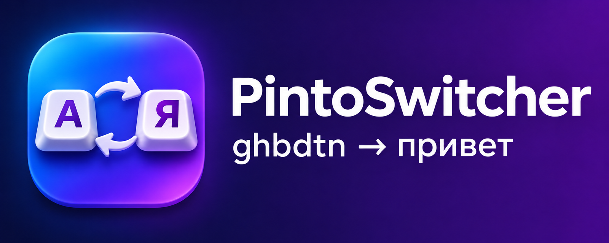
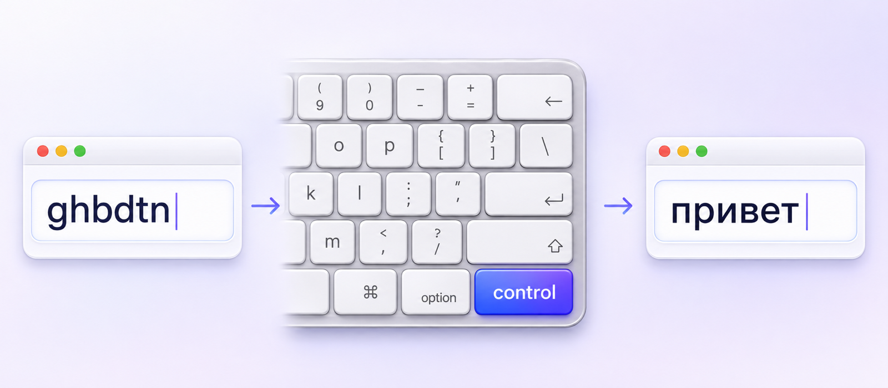
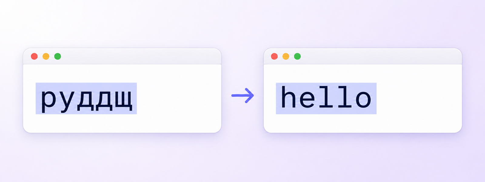

<p align="center">
  
</p>

<p align="center">
  <a href="https://github.com/makamekm/PintoSwitcher/releases/latest"></a>
  
  
  
</p>

# PintoSwitcher

Лёгкая и стабильная замена Punto Switcher для macOS. Живёт в строке меню, показывает текущую
раскладку (`EN` / `RU`) и **одним нажатием правого Control** исправляет текст, набранный не в той раскладке.

<p align="center">
  
</p>

## Что умеет

| Ситуация | Нажатие правого Control |
|---|---|
| Только что набрали слово не в той раскладке | Слово стирается и набирается заново в правильной раскладке: `ghbdtn` → `привет`. Раскладка системы переключается. |
| Текст выделен | Заменяется **только выделение**, после замены оно остаётся выделенным. |
| Курсор перемещали, выделения нет | Исправляется слово перед курсором. |
| Исправлять нечего | Просто переключается раскладка системы. |
| Нажали ещё раз сразу после исправления | Исправление отменяется. |

<p align="center">
  
</p>

- Замена делается **симуляцией клавиатуры**: Backspace и набор нужных символов. Буфер обмена не трогается.
  Исключение — многострочное выделение: его вставка идёт через буфер, после чего прежнее содержимое
  восстанавливается.
- Работает в терминалах (Terminal, iTerm2, Ghostty, Warp, kitty…): исправляется набранное слово и выделение
  в строке ввода.
- Control в сочетаниях (Ctrl+C, Ctrl+клик, Ctrl+прокрутка) и долгое удержание исправление не запускают.
- В полях паролей текст не трогается, только переключается раскладка.
- Раскладки берутся из системы через `UCKeyTranslate`, поэтому подходят «Русская», «Русская — ПК», ABC, U.S. и другие.

## Почему не старый Punto

- **Не падает и не вешает ввод.** Перехват клавиатуры работает только на чтение: даже если программа
  зависнет, печатать вы сможете. Если macOS отключит перехват (сон, таймаут), он поднимается сам.
- Нативное приложение на Swift без зависимостей, Universal-сборка для Apple Silicon и Intel.
- Ничего не отправляет в сеть и не пишет набранный текст на диск.

## Установка

1. Скачайте `PintoSwitcher-x.y.z.dmg` со страницы [Releases](https://github.com/makamekm/PintoSwitcher/releases/latest).
2. Откройте DMG и перетащите **PintoSwitcher** в **Программы**.
3. Запустите приложение. Сборка подписана, но не нотаризована Apple, поэтому при первом запуске macOS
   его заблокирует. Откройте **Системные настройки → Конфиденциальность и безопасность** и нажмите
   **«Всё равно открыть»**. Либо выполните в Терминале:
   ```sh
   xattr -dr com.apple.quarantine /Applications/PintoSwitcher.app
   ```
4. Разрешите доступ: **Конфиденциальность и безопасность → Универсальный доступ → PintoSwitcher**.
   Пока доступа нет, в строке меню рядом с раскладкой горит оранжевый ⚠.

> Не запускайте PintoSwitcher одновременно со старым Punto Switcher: обе программы будут реагировать на Control.

## Меню

- **Включено**: временно выключить, не закрывая программу.
- **Клавиша**: правый Control (по умолчанию), левый или любой.
  На встроенной клавиатуре MacBook правого Control нет, выберите левый.
- **Переключать раскладку после исправления**, **Оставлять выделение**, **Исправлять слово перед курсором**.
- **Не работать в «…»**: исключение для текущего приложения. Там Control только меняет раскладку.
- **Запускать при входе в систему**.

## Сборка из исходников

Нужны только Command Line Tools (`xcode-select --install`).

```sh
./build.sh           # build/PintoSwitcher.app + самотест
./build.sh install   # собрать, установить в /Applications и запустить
./release.sh         # собрать DMG для релиза в build/
```

Если в связке ключей есть сертификат *Apple Development* или *Developer ID*, сборка подписывается им,
и разрешение «Универсальный доступ» не сбрасывается при пересборке.
Проверка логики без перехвата клавиатуры: `build/PintoSwitcher.app/Contents/MacOS/PintoSwitcher --selftest`.

| Файл | Что внутри |
|---|---|
| `Sources/KeyboardMonitor.swift` | CGEventTap, буфер набора, распознавание одиночного Control |
| `Sources/Converter.swift` | Выбор режима (слово / выделение / терминал / слово перед курсором) и замена |
| `Sources/Layouts.swift` | Раскладки, таблицы клавиш, перекодирование, определение языка |
| `Sources/SystemIO.swift` | Синтез нажатий, Accessibility API, временный буфер обмена |
| `Sources/AppDelegate.swift` | Значок и меню в строке меню, настройки, автозапуск |
| `Sources/SelfTest.swift` | Самотест |

## English

PintoSwitcher is a free, open-source Punto Switcher alternative for macOS 13+ (Apple Silicon and Intel).
Type `ghbdtn` in the wrong layout, tap the **right Control** key once, and it becomes `привет`, with the
system input source switched to match. With text selected, only the selection is converted. A tap with
nothing to fix just switches the layout. Download the DMG from
[Releases](https://github.com/makamekm/PintoSwitcher/releases/latest), then grant Accessibility access.

Art and icon were generated with OpenAI Codex. Licensed under MIT.
